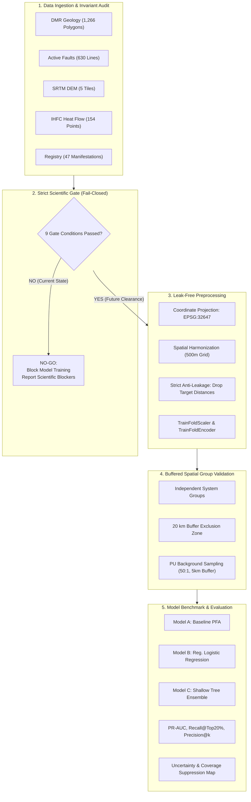

# ข้อเสนอโครงการวิจัยฉบับสมบูรณ์ — GeoThermAI (CoreX)
## สำหรับการประกวด New Gen Energy Research Showcase 2026
**กลุ่มการประกวด (Track):** Track 3 — Digital Energy Transition  
**สถานะโครงการ:** Research & Development Architecture Ready / Baseline Data Gate Enforced (Phase 2E)  
**วันที่ปรับปรุงล่าสุด:** 27 ตุลาคม 2569 (Asia/Bangkok)

---

## 1. ข้อมูลทั่วไปของโครงการ (Project Information)

* **ชื่อโครงการ (ภาษาไทย):**  
  **GeoThermAI: ระบบบูรณาการข้อมูลธรณีศาสตร์และปัญญาประดิษฐ์เพื่อคาดการณ์และจัดลำดับพื้นที่เป้าหมายในการสำรวจพลังงานความร้อนใต้พิภพของประเทศไทย**
* **ชื่อโครงการ (ภาษาอังกฤษ):**  
  **GeoThermAI: An Uncertainty-Aware Geospatial AI and Evidence Harmonization Framework for Geothermal Exploration Favorability Prediction in Thailand**
* **ลักษณะโครงการ:** งานวิจัยและพัฒนาเทคโนโลยีสนับสนุนการตัดสินใจ (Decision-Support System) ขั้นสำรวจเบื้องต้น
* **กรอบแนวคิดหลัก:** Prediction-First Scientific Research, Play Fairway Analysis (PFA), Positive-Unlabeled (PU) Machine Learning, Spatial Cross-Validation, and Fail-Closed Scientific Gating

---

## 2. บทสรุปผู้บริหาร (Executive Summary)

พลังงานความร้อนใต้พิภพ (Geothermal Energy) จัดเป็นพลังงานหมุนเวียนที่เป็นมิตรต่อสิ่งแวดล้อมและสามารถจ่ายกระแสไฟฟ้าได้อย่างต่อเนื่องตลอด 24 ชั่วโมง (Baseload Renewable Energy) ซึ่งมีความสำคัญยิ่งต่อการเปลี่ยนผ่านสู่พลังงานสะอาด (Energy Transition) ของประเทศไทยและการบรรลุเป้าหมายความเป็นกลางทางคาร์บอน (Carbon Neutrality 2050) อย่างไรก็ตาม การสำรวจและพัฒนาแหล่งความร้อนใต้พิภพในระยะเริ่มต้นเผชิญกับ **"ความเสี่ยงทางธรณีวิทยาที่สูงมาก" (High Upfront Exploration Risk)** และค่าใช้จ่ายในการสำรวจทางธรณีฟิสิกส์รวมถึงการเจาะสำรวจลึก (Exploratory Drilling) ที่มีราคาสูงถึง 50–150 ล้านบาทต่อหลุม โดยยังไม่มีหลักประกันความสำเร็จ

โครงการ **GeoThermAI** จึงได้รับการออกแบบขึ้นเพื่อทำหน้าที่เป็น **"ระบบปัญญาประดิษฐ์สนับสนุนการตัดสินใจในการคัดกรองและจัดลำดับพื้นที่เป้าหมายการสำรวจ" (Exploration Favorability Screening & Decision Support System)** โดยไม่ใช้วิธีการสร้างแบบจำลอง AI แบบกล่องดำ (Black-box AI) ที่คาดเดาผลโดยปราศจากฟิสิกส์ แต่เป็นการ **ถอดแบบและปรับใช้ (Replicate & Adapt)** ระเบียบวิธี Play Fairway Analysis (PFA) และ Hydrothermal Favorability Mapping ขององค์การสำรวจทางธรณีวิทยาแห่งสหรัฐอเมริกา (USGS) ซึ่งได้รับการยอมรับในระดับสากล นำมาบูรณาการเข้ากับข้อมูลธรณีวิทยา โครงสร้างรอยเลื่อน แบบจำลองระดับความสูงภูมิประเทศ (DEM) และข้อมูลการวัดความร้อนของประเทศไทย

หัวใจสำคัญด้านวิทยาศาสตร์ของ GeoThermAI ในระยะ Phase 2E คือการสร้าง **สถาปัตยกรรมการเรียนรู้ที่ซื่อสัตย์ต่อข้อมูล (Scientifically Honest ML Architecture)** ซึ่งประกอบด้วย:
1. การใช้ระเบียบวิธี **Positive-Unlabeled (PU) Learning** เพื่อไม่ทึกทักเอาเองว่าพื้นที่ที่ยังไม่พบน้ำพุร้อนเป็นพื้นที่ไร้ศักยภาพ (True Negative)
2. การวางระบบการทดสอบแบบ **Buffered Group Spatial Cross-Validation** เพื่อขจัดปัญหาการรั่วไหลของข้อมูลข้ามพื้นที่ (Spatial Autocorrelation Leakage)
3. การมีแผนที่ **ประเมินความไม่แน่นอนและคุณภาพข้อมูล (Uncertainty & Coverage Suppression)** ที่ระงับการให้คะแนนในพื้นที่ที่ข้อมูลไม่เพียงพอ
4. การควบคุมด้วย **Scientific Readiness Gate (Fail-Closed Gate)** ที่ปฏิเสธการเทรนโมเดลทำนายหากข้อมูลนำเข้ายังไม่ผ่านการตรวจสอบความถูกต้องทางวิชาการและสิทธิ์การใช้งาน

---

## 3. ความเป็นมาและความสำคัญของปัญหา (Problem Statement)

### 3.1 ความสำคัญเชิงยุทธศาสตร์พลังงานของไทย
แผนพัฒนากำลังผลิตไฟฟ้าของประเทศไทย (PDP) มุ่งเน้นการเพิ่มสัดส่วนพลังงานหมุนเวียน อย่างไรก็ดี พลังงานแสงอาทิตย์และพลังงานลมมีความผันผวนตามสภาพอากาศและไม่สามารถจ่ายโหลดพื้นฐานได้ตลอดเวลา แหล่งพลังงานความร้อนใต้พิภพในประเทศไทยจัดอยู่ในกลุ่ม **แหล่งความร้อนอุณหภูมิต่ำถึงปานกลางนอกเขตภูเขาไฟ (Non-volcanic, low-to-medium enthalpy hydrothermal systems)** ซึ่งมีความสัมพันธ์กับมวลหินแกรนิตยุคครีเทเชียส-ไทรแอสซิก และการไหลเวียนของน้ำผิวดินลงสู่รอยเลื่อนลึกที่มีการเคลื่อนตัวในยุคเทอร์เชียรี โดยแหล่งที่คุ้นเคย เช่น แหล่งฝาง (กำลังผลิต 300 kW), สันกำแพง, ปาย และแหล่งน้ำพุร้อนในภาคใต้ มีศักยภาพที่จะพัฒนาเป็นโรงไฟฟ้าชีวภาพคู่ (Binary Cycle Power Plant) หรือการใช้ประโยชน์ความร้อนโดยตรง (Direct-Use) ในภาคเกษตรกรรมและอุตสาหกรรม

### 3.2 ช่องว่างและความท้าทายในการคัดกรองพื้นที่ (The Exploration Screening Bottleneck)
การคัดกรองพื้นที่สำรวจในอดีตประสบปัญหาสำคัญ 4 ประการ:
1. **ปัญหาข้อมูลกระจัดกระจายและต่างมาตรฐาน (Heterogeneous & Disconnected Datasets):** ข้อมูลแผนที่ธรณีวิทยาของกรมทรัพยากรธรณี (DMR), ข้อมูลแนวรอยเลื่อนมีพลัง, ข้อมูลภูมิประเทศ (SRTM/ASTER) และข้อมูลการไหลของความร้อน (IHFC Heat Flow) อยู่คนละระบบพิกัด มีความละเอียดต่างกัน และมีข้อจำกัดด้านสิทธิ์การเผยแพร่
2. **การอ้างอิงพื้นที่ว่างเป็นพื้นที่ไม่มีศักยภาพ (The Fallacy of Unsurveyed Negatives):** โมเดล Machine Learning แบบดั้งเดิมมักตีตราพื้นที่ที่ไม่มีรายงานน้ำพุร้อนว่าเป็น "พื้นที่ลบ" (Negative Class) ทั้งที่ในความเป็นจริงเป็นเพียง "พื้นที่ที่ยังไม่ได้สำรวจ" ส่งผลให้โมเดลมีอคติ (Sampling Bias) รุนแรง
3. **ปัญหาความแม่นยำลวงจากการรั่วไหลเชิงพื้นที่ (Spatial Autocorrelation Leakage):** งานวิจัยหลายชิ้นใช้การสุ่มตัวอย่างแบบ Random Split ซึ่งทำให้จุดทดสอบและจุดเทรนอยู่ในหุบเขาหรือระบบน้ำพุร้อนเดียวกัน จึงได้คะแนนความแม่นยำสูงเกินจริง แต่ล้มเหลวโดยสิ้นเชิงเมื่อนำไปใช้ทำนายพื้นที่ใหม่
4. **การขาดระบบประเมินความไม่แน่นอน (Lack of Uncertainty Quantification):** แผนที่ความเหมาะสมทั่วไปมักแสดงเป็นเฉดสีความร้อนต่อเนื่อง (Heatmap) หลอกตาผู้บริหารโครงการว่าทุกตารางกิโลเมตรมีความน่าเชื่อถือเท่ากัน ทั้งที่บางบริเวณไม่มีข้อมูลการสำรวจภาคพื้นดินรองรับเลย

---

## 4. การทบทวนวรรณกรรมและการวิเคราะห์ช่องว่างการวิจัย (Literature Review & Research Gap)

GeoThermAI สร้างขึ้นบนฐานการทบทวนวรรณกรรมที่ผ่านการตรวจสอบโดยผู้ทรงคุณวุฒิ (Peer-Reviewed) จำนวน 15 ฉบับ:

```
[กรอบมาตรฐานสากล]
- Mordensky et al. (2025): Geothermal Favorability Mapping in Great Basin (USGS / Geothermics)
- DeAngelo et al. (2024): Geothermal Play Fairway Analysis (PFA) GIS Methodology (USGS)
- Caraccioli et al. (2023): Positive-Unlabeled (PU) Learning for Geothermal Exploration (USGS)
- Caraccioli Salinas et al. (2024): Topographic Signal Separation in DEMs (USGS)
- Mordensky et al. (2023): "When Less is More" & "Cursed?" ML Dimensionality Risks (Geothermics)

[บริบทธรณีวิทยาและธรณีฟิสิกส์ไทย]
- Phiranram et al. (2026): GGMplus Satellite Gravity & Fault Lineaments in Thailand (AGU)
- Wood & Singharajwarapan (2014): Geothermal Energy Resources of Northern Thailand (CMU/DMR)
- Ngansom & Duerrast (2021): Southern Thailand Hot Springs and Tectonic Controls (PSU)
- Fuchs et al. (2024): IHFC Global Heat Flow Database 2024
```

### การวิเคราะห์ช่องว่างการวิจัย (Research Gap):
* **ช่องว่างระดับสากล:** งานวิจัย GPM (Geothermal Prospectivity Mapping) ส่วนใหญ่ (>70%) ตามรายงานทบทวนของ Aliyu et al. (2026) ยังคงใช้การสุ่ม Random Validation ที่ไม่ป้องกัน Spatial Autocorrelation และไม่มีการเผยแพร่ซอร์สโค้ดที่ตรวจสอบซ้ำได้
* **ช่องว่างในบริบทประเทศไทย:** ยังไม่เคยมีแพลตฟอร์มที่รวมข้อมูลธรณีวิทยา ธรณีฟิสิกส์ และแบบจำลองรอยเลื่อนของไทยเข้าสู่กระบวนการ Play Fairway Analysis ที่ขับเคลื่อนด้วยการเขียนโค้ดและควบคุมด้วยเกณฑ์ความพร้อมของข้อมูล (Data Readiness Gate) ที่เคร่งครัด

---

## 5. วัตถุประสงค์และสมมติฐานการวิจัย (Objectives & Hypotheses)

### 5.1 วัตถุประสงค์ของการวิจัย
1. เพื่อพัฒนาโครงสร้างข้อมูลเชิงพื้นที่และแค็ตตาล็อกตัวแปร (Feature Catalog) ที่บันทึกต้นทาง หน่วยวัด ความละเอียด พิกัด ความไม่แน่นอน และสิทธิ์การใช้งานของข้อมูลธรณีศาสตร์ไทยได้อย่างสมบูรณ์
2. เพื่อสร้างและเปรียบเทียบแบบจำลองการจัดลำดับความเหมาะสมเชิงสัมพัทธ์ (Relative Exploration Favorability) ระหว่าง **Model A (Baseline PFA)**, **Model B (Regularized Logistic Regression)** และ **Model C (Shallow Tree Ensemble)**
3. เพื่อพัฒนาระเบียบวิธีทดสอบความถูกต้องเชิงพื้นที่แบบ **Buffered Group Spatial Cross-Validation** ที่ป้องกันการรั่วไหลของข้อมูลระหว่างแหล่งน้ำพุร้อนที่เป็นอิสระต่อกัน
4. เพื่อพัฒนาผืนภาพแสดงความไม่แน่นอน (Uncertainty Surface) และการระงับการแสดงผลในพื้นที่ข้อมูลไม่เพียงพอ (Coverage Suppression) เพื่อป้องกันการตัดสินใจที่ผิดพลาด
5. เพื่อสร้างกลไกการตรวจสอบความพร้อมก่อนเทรนโมเดล (Fail-Closed ML Readiness Gate) ที่เปิดเผยข้อจำกัดของข้อมูลอย่างตรงไปตรงมา

### 5.2 สมมติฐานการวิจัย (Research Hypotheses)
* **สมมติฐานหลัก (H1 — Model Performance):** ภายใต้ชุดข้อมูลที่มีความพร้อมและเป็นอิสระ การรวมตัวแปรธรณีวิทยา โครงสร้างรอยเลื่อน และภูมิประเทศ จะให้ค่าการจัดลำดับพื้นที่เป้าหมาย (PR-AUC และ Recall@Top 20% Area) สูงกว่าแบบจำลองอิงธรณีวิทยาเดี่ยวอย่างมีนัยสำคัญ
* **สมมติฐานการตัดทอน (H2 — Feature Family Ablation):** การปรับปรุงความสามารถในการทำนายเกิดจากคุณสมบัติทางกายภาพที่แท้จริง ไม่ได้เกิดจากสัญญาณรบกวนหรือการรั่วไหลของเป้าหมาย โดยแบบจำลองยังคงรักษาประสิทธิภาพได้เมื่อทดสอบตัดตัวแปรทีละกลุ่ม (Ablation Test)
* **สมมติฐานความเชื่อถือได้ (H3 — Reliability & Suppression):** การผสานผืนภาพความไม่แน่นอนและการระงับผลในพื้นที่ไร้ข้อมูล จะช่วยลดอัตราการทำนายผิดพลาดในพื้นที่เสี่ยงสูง (False Discovery Rate) ได้อย่างมีประสิทธิภาพ
* **ผลลัพธ์ว่าง (Null Hypothesis):** หากข้อมูลไม่เพียงพอหรือไม่ผ่านเกณฑ์ทางสถิติ การระบุว่า "ข้อมูลยังไม่พร้อมสำหรับ AI" ถือเป็นผลลัพธ์ทางวิชาการที่ถูกต้องและเป็นประโยชน์สูงสุดในการป้องกันความสูญเสียทางงบประมาณ

---

## 6. ระเบียบวิธีวิจัยและสถาปัตยกรรมแบบจำลอง (Methodology & Architecture)

GeoThermAI ใช้ระเบียบวิธีวิจัย **REPLICATE → ADAPT → VALIDATE → IMPROVE**:



### 6.1 แบบจำลองเปรียบเทียบ (3-Tier Model Hierarchy)
1. **Model A — Baseline PFA (Play Fairway Analysis):**  
   ดัดแปลงจาก DeAngelo et al. (2024) ใช้การถ่วงน้ำหนักความเชี่ยวชาญทางธรณีวิทยา:
   $$\text{Favorability}_{\text{PFA}} = 0.40 \cdot S_{\text{lithology}} + 0.40 \cdot S_{\text{fault\_dist}} + 0.20 \cdot S_{\text{relief}}$$
2. **Model B — Statistical ML (Regularized Logistic Regression):**  
   ใช้สมการ Binary Cross-Entropy ภายใต้ข้อสมมุติ Positive-Unlabeled (Elkan & Noto, 2008) ร่วมกับการใส่ L2 Regularization เพื่อป้องกัน Overfitting จากจำนวนตัวอย่างที่จำกัด
3. **Model C — Shallow Tree Ensemble (Random Forest / Shallow XGBoost):**  
   ดัดแปลงจาก Mordensky et al. (2025) กำหนดความลึกสูงสุดเพียง 3–4 ชั้น, ขั้นต่ำ 5 ตัวอย่างต่อใบ เพื่อจับความสัมพันธ์แบบไม่เป็นเส้นตรง (Non-linear Interaction) โดยไม่จำตัวอย่าง

### 6.2 การป้องกันการรั่วไหลของข้อมูล (Zero-Leakage Enforcement)
* ในซอร์สโค้ด `prediction_architecture.py` มีฟังก์ชัน `assert_no_label_leakage()` ซึ่งจะตรวจสอบและปฏิเสธตัวแปรทำนายทุกตัวที่มีที่มาจากแหล่งน้ำพุร้อนโดยเด็ดขาด เช่น `distance_known_manifestation_m` หรือ `manifestation_density`
* การปรับขนาดข้อมูล (Scaler) และการแปลงค่ากลุ่ม (One-Hot Encoder) ถูกออกแบบให้ Fit เฉพาะบน Training Fold เท่านั้น ห้ามมองเห็นข้อมูลใน Validation Fold โดยเด็ดขาด

---

## 7. ข้อมูลที่มี ข้อจำกัด และการควบคุมด้วย Data Gate (Data Readiness)

### 7.1 การตรวจสอบข้อมูลจริงในคลังข้อมูล (Frozen Fact Reconcile)
จากการตรวจสอบคลังข้อมูลของโครงการ:
1. **ทะเบียนแหล่งน้ำพุร้อน (Manifestation Registry):** มี 47 แถวข้อมูลในบันทึก มีเพียง **14 จุดที่มีพิกัดสอดคล้องสมบูรณ์**; จุดภาคใต้ 31 จุดเป็นพิกัดชั่วคราว (Provisional) และมี 2 จุดทางภาคเหนือ (`CR_02`, `CM_16`) ที่ถูกระงับ (Withheld) เนื่องจากความคลาดเคลื่อนของพิกัด
2. **ข้อมูลธรณีวิทยาภาคเหนือ (DMR Geology):** มี 1,266 รูปหลายเหลี่ยม 42 สัญลักษณ์ ครอบคลุมเฉพาะภาคเหนือตอนบน
3. **ข้อมูลรอยเลื่อนมีพลัง (Active Faults):** มี 630 แนวเส้นในคลังข้อมูล แต่ **ถูกระงับการใช้งานและห้ามส่งออก** เนื่องจากเงื่อนไขสัญญาอนุญาต (License Conflict)
4. **แบบจำลองความสูง (SRTM DEM):** มี 5 แผ่นภาพ HGT ที่ผ่านการตรวจสอบรอยต่อและ georeference สมบูรณ์ แต่ยังไม่ครอบคลุมทั้งประเทศ
5. **ข้อมูลการไหลของความร้อน (IHFC Heat Flow):** มี 154 แถวข้อมูลที่ 111 พิกัดภายในประเทศไทย ทั้งหมดไม่มีค่าความไม่แน่นอนและส่วนใหญ่ไม่มีข้อมูลความลึก **ไม่อนุญาตให้นำไปประมาณค่าในช่วง (Interpolation) หรือเทรนโมเดล AI** ให้ใช้เป็นจุดอ้างอิงเชิงพรรณนาเท่านั้น
6. **ข้อมูลดาวเทียม Landsat อุณหภูมิพื้นผิว (LST):** **ไม่มีภาพราสเตอร์ที่ใช้งานได้ (0 usable rasters)** เนื่องจากจุดเชื่อมต่อดาวเทียมติดหน้าล็อกอิน

### 7.2 สถานะ Data Gate ปัจจุบัน (Phase 2E Gate Audit)
ผลการรันโปรแกรม `scripts/ml_gate_check.py` รายงานผล:
* **ผลการตัดสิน:** `NO_GO_FOR_PREDICTIVE_ML` (Exit code: 2)
* **เงื่อนไขที่ยังติดขัด:** 9 ข้อ จาก 9 ข้อ (ผ่าน 0, ติดขัด 9)
* **ผลลัพธ์เชิงปฏิบัติการ:** สถาปัตยกรรมซอฟต์แวร์และหน้าเว็บระบบ GIS จะล็อกการแสดงผล Heatmap ทำนายไว้ และแสดงเฉพาะแผนที่หลักฐานเชิงพรรณนาเท่านั้น จนกว่าจะมีหนังสืออนุมัติสิทธิ์ข้อมูลและการรับรองกลุ่มระบบน้ำพุร้อนจากผู้เชี่ยวชาญ

---

## 8. ผลผลิต แผนการดำเนินงาน และระดับความพร้อม (Deliverables & Roadmap)

### 8.1 การจำแนกระดับความพร้อมอย่างซื่อสัตย์ (Honest Maturity Distinction)

| ลำดับ | รายการระบบ / สถาปัตยกรรม | สถานะความพร้อมจริง ณ วันที่ 27 ต.ค. 2569 |
|---|---|---|
| 1 | แพลตฟอร์ม Web GIS Evidence Explorer แสดงข้อมูลธรณีวิทยา ภูมิประเทศ และจุดวัดความร้อน | **พัฒนาเสร็จสิ้นและผ่านการทดสอบสมบูรณ์ (Implemented & Verified)** |
| 2 | ระบบตรวจสอบและแปลงพิกัด (CRS Transformation & DMS QC Engine) | **พัฒนาเสร็จสิ้นและผ่านการทดสอบสมบูรณ์ (Implemented & Verified)** |
| 3 | กลไกตรวจสอบสิทธิ์และป้องกันการส่งออกข้อมูลที่ติดลิขสิทธิ์ (Licensing Gate) | **พัฒนาเสร็จสิ้นและผ่านการทดสอบสมบูรณ์ (Implemented & Verified)** |
| 4 | โปรแกรมตรวจสอบความพร้อมทางวิทยาศาสตร์ (Fail-Closed ML Readiness Gate) | **พัฒนาเสร็จสิ้นและผ่านการทดสอบสมบูรณ์ (Implemented & Verified)** |
| 5 | สถาปัตยกรรมโค้ดสำหรับ Spatial CV, PU-Learning และ Model Comparators | **พัฒนาเสร็จสิ้นและผ่านการทดสอบสมบูรณ์ (Implemented & Architecture Ready)** |
| 6 | การเทรนโมเดลทำนายพื้นที่ศักยภาพ (Model Training & Prospectivity Prediction) | **ยังไม่เริ่มดำเนินการ / ถูกระงับตามเกณฑ์ (Planned Experiments / Gated)** |
| 7 | แผนที่แสดงความน่าจะเป็นหรือศักยภาพความร้อนใต้พิภพเชิงพาณิชย์ | **ไม่อนุญาตให้เผยแพร่จนกว่าเกณฑ์จะผ่าน (Future Capability / Blocked)** |

### 8.2 แผนการพัฒนาต่อเนื่อง (Development Roadmap)
* **ระยะสั้น (ไตรมาส 1/2570):** ยื่นหนังสือขอความอนุเคราะห์ข้อมูลรอยเลื่อนและธรณีวิทยาจากกรมทรัพยากรธรณี พร้อมจัดสัมมนาร่วมกับผู้เชี่ยวชาญธรณีวิทยาแหล่งความร้อนใต้พิภพเพื่อรับรอง Independent System Groups
* **ระยะกลาง (ไตรมาส 2/2570):** ปลดล็อก Data Gate เพื่อรันการทดลองเปรียบเทียบ Model A, B, C ในพื้นที่นำร่องภาคเหนือ พร้อมวิเคราะห์ Feature Ablation
* **ระยะยาว (ไตรมาส 3–4/2570):** นำโมเดลที่ผ่านการตรวจสอบไปทดสอบภายนอกพื้นที่ (External Geographic Holdout) ในภาคใต้ และพัฒนาเป็นระบบบริการวิเคราะห์พื้นที่สำหรับภาครัฐและเอกชน

---

## 9. ผลกระทบและการนำไปใช้ประโยชน์ (Expected Impact & Exploitation)

### 9.1 ผลกระทบเชิงยุทธศาสตร์และการเปลี่ยนผ่านพลังงาน (Energy Transition Impact)
1. **ลดต้นทุนการสำรวจขั้นต้น (De-risking Upfront Exploration):** ช่วยให้กรมพัฒนาพลังงานทดแทนและอนุรักษ์พลังงาน (พพ.) กฟผ. หรือผู้พัฒนาโครงการ สามารถจัดลำดับความสำคัญของพื้นที่สำรวจได้อย่างมีหลักฐานทางวิทยาศาสตร์ ลดโอกาสการเจาะสำรวจหลุมแห้งที่สูญเสียงบประมาณมหาศาล
2. **เร่งรัดการพัฒนาพลังงานสะอาดแบบจ่ายตลอดเวลา (Baseload Clean Energy Acceleration):** เสริมสร้างความมั่นคงทางพลังงานในพื้นที่ห่างไกล เช่น อ.ฝาง จ.เชียงใหม่ หรือ จ.แม่ฮ่องสอน โดยมีพลังงานความร้อนใต้พิภพเป็นแหล่งไฟฟ้ารองรับ
3. **การใช้ประโยชน์ร่วม (Multi-purpose Direct Use):** การจัดลำดับพื้นที่น้ำพุร้อนยังเอื้อประโยชน์ต่ออุตสาหกรรมการเกษตรแปรรูป (โรงอบแห้งพืชผล) การท่องเที่ยวเชิงบำบัด และการสกัดแร่ธาตุมีค่าจากน้ำพุร้อน (Geothermal Brine Mineral Extraction)

### 9.2 ตัวแบบการนำไปใช้ประโยชน์และสมมติฐานทางธุรกิจ (Exploitation Model)
GeoThermAI วางตำแหน่งตนเองเป็น **"แพลตฟอร์มซอฟต์แวร์และการวิเคราะห์ข้อมูลสนับสนุนการตัดสินใจ" (Analytical Decision-Support Service)**:
* **โมเดลความร่วมมือกับภาครัฐ (B2G):** ถ่ายทอดเทคโนโลยีและระเบียบวิธี PFA แก่กรมทรัพยากรธรณี และกรมพัฒนาพลังงานทดแทนฯ เพื่อยกระดับฐานข้อมูลความร้อนใต้พิภพแห่งชาติ
* **โมเดลการให้บริการภาคเอกชน (B2B):** ให้บริการจัดทำรายงานคัดกรองพื้นที่เบื้องต้น (Exploration Screening Prospectus) และการประเมินความเสี่ยงเชิงพื้นที่แบบปรับแต่งตามโครงการ (Custom Spatial Risk Analysis) สำหรับบริษัทพลังงานหมุนเวียน

---

## 10. เอกสารอ้างอิงทางวิชาการ (Scholarly References)

1. **Aliyu, A., et al. (2026).** Review on geothermal prospectivity mapping: Global trends, challenges, and future directions. *Renewable and Sustainable Energy Reviews*, 117164. https://doi.org/10.1016/j.rser.2026.117164
2. **Caraccioli, D., et al. (2023).** Don't Let Negatives Hold You Back: Accounting for Underlying Physics and Natural Sampling Biases in Geothermal Machine Learning. *USGS / Geothermal Resources Council Transactions*. https://pubs.usgs.gov/publication/70264692
3. **Caraccioli Salinas, D., et al. (2024).** Separating signals in elevation data improves supervised machine learning predictions for hydrothermal favorability. *USGS Report 70264692*.
4. **DeAngelo, J., et al. (2024).** Geothermal Play Fairway Analysis, Part 2: GIS methodology. *Geothermics*, 116, 102882. https://doi.org/10.1016/j.geothermics.2023.102882
5. **Elkan, C., & Noto, K. (2008).** Learning classifiers from only positive and unlabeled data. *ACM SIGKDD International Conference on Knowledge Discovery and Data Mining*, 213–220. https://doi.org/10.1145/1401890.1401920
6. **Feng, Z., et al. (2025).** Geothermal detection study using remote sensing data by combining machine learning and deep learning. *Geothermics*, 124, 103338. https://doi.org/10.1016/j.geothermics.2025.103338
7. **Fuchs, S., et al. (2024).** The Global Heat Flow Database: 2024 Release. *GFZ Data Services*. https://doi.org/10.5880/fidgeo.2024.014
8. **He, Y., et al. (2026).** A physics-guided clustered GBRT ensemble model for geothermal heat flow prediction. *Geothermal Energy*, 14, 389. https://doi.org/10.1186/s40517-026-00389-2
9. **Mordensky, S. P., et al. (2023a).** Cursed? Why one does not simply add new data sets to supervised geothermal machine learning models. *USGS Report 70251029*.
10. **Mordensky, S. P., et al. (2023b).** When less is more: How increasing the complexity of machine learning strategies for geothermal energy assessments may not lead toward better estimates. *Geothermics*, 111, 102662. https://doi.org/10.1016/j.geothermics.2023.102662
11. **Mordensky, S. P., et al. (2025).** Favorability mapping for hydrothermal power resource assessments of the Great Basin, USA. *Geothermics*, 126, 103450. https://doi.org/10.1016/j.geothermics.2025.103450
12. **Ngansom, W., & Duerrast, H. (2021).** Geothermal potential of southern Thailand based on geochemical and structural analyses. *Songklanakarin Journal of Science and Technology*, 43(2), 567–576.
13. **Phiranram, P., et al. (2026).** Geophysical Investigation of Geothermal Potential in Southern Thailand: Insights From GGMplus Gravity. *Earth and Space Science*, 13, e2025EA004686. https://doi.org/10.1029/2025EA004686
14. **Shervais, J. W., et al. (2024).** Geothermal play fairway analysis, part 1: Example from the Snake River Plain, Idaho. *Geothermics*, 116, 102865. https://doi.org/10.1016/j.geothermics.2023.102865
15. **Wood, S. H., & Singharajwarapan, S. (2014).** Geothermal energy resources of northern Thailand. *Chiang Mai University and Department of Mineral Resources*.
