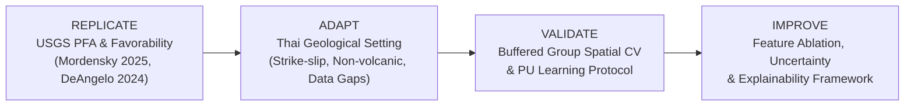

# GeoThermAI Phase 2E — Prediction Methodology Specification
**A Scientifically Defensible, Research-Backed Geothermal Prospectivity Prediction Framework for Thailand**

**Document Version:** 1.0 (Phase 2E)  
**Date:** 2026-10-27 (Asia/Bangkok)  
**Status:** PREREGISTERED RESEARCH DESIGN; **PREDICTIVE TRAINING CURRENTLY BLOCKED BY ML GATE**

---

## 1. Scientific Objective and Scope Boundaries

### 1.1 Primary Objective
The primary objective of GeoThermAI is:
$$\text{Predicting and ranking relative geothermal exploration favorability using multiple geological and geospatial datasets in Thailand.}$$

Relative exploration favorability represents an ordinal ranking indicating which geographic sub-regions exhibit a higher confluence of surface geological and geophysical conditions associated with hydrothermal systems, prioritizing areas for subsequent, capital-intensive exploration (detailed geophysics and exploratory drilling).

### 1.2 Explicit Non-Claim Policy (Scientific Boundaries)
To maintain strict scientific integrity, GeoThermAI enforces the following non-claims:
1. **Not Reservoir Confirmation:** A high favorability score does NOT confirm the existence of a commercial subsurface geothermal reservoir.
2. **Not Calibrated Discovery Probability:** Relative favorability scores are uncalibrated ordinal indices; they do NOT represent true statistical occurrence probabilities ($P(\text{geothermal} = 1)$).
3. **Not Drilling Success:** The model does NOT estimate commercial drilling success rates, well flow rates, or enthalpy.
4. **Not Megawatts (MW) or Levelized Cost of Electricity (LCOE):** No electrical capacity, power output, or cost-saving figures are computed or claimed.
5. **No Data Fabrication:** Missing geological attributes, unmapped faults, or unmeasured heat-flow depths are NEVER synthetically imputed or extrapolated.

---

## 2. Research Strategy: REPLICATE → ADAPT → VALIDATE → IMPROVE



### 2.1 Replicate (International Scientific Foundations)
We replicate the foundational architectures established in recent benchmark studies:
- **Play Fairway Analysis (PFA) GIS Methodology** (DeAngelo et al., 2024; USGS Report 70250631).
- **USGS Hydrothermal Favorability Mapping** (Mordensky et al., 2025; *Geothermics*).
- **Signal Separation in Digital Elevation Models** (Caraccioli Salinas et al., 2024; USGS).
- **Positive-Unlabeled (PU) Sampling Strategies** (Caraccioli et al., 2023; USGS / GRC).

### 2.2 Adapt (Tailored to Thailand's Geological & Data Realities)
1. **Tectonic Setting:** Unlike the extensional Basin and Range (USA) or volcanic arcs (Indonesia/Japan), Thailand's geothermal systems are **non-volcanic, intraplate hydrothermal systems** driven by:
   - Deep convective circulation along Tertiary strike-slip and extensional fault networks (e.g., Mae Chan, Mae Tha, Ranong, Khlong Marui faults).
   - Radiogenic heat production from Cretaceous-Triassic granitic plutons.
2. **Data Gaps & Spatial Incompleteness:** Rather than assuming nationwide continuous rasters, the architecture must operate under incomplete northern geology (1,266 polygons), 5 isolated SRTM DEM tiles, 154 sparse heat-flow point observations, and zero usable Landsat surface temperature rasters.

---

## 3. Mathematical and Algorithmic Formulations

### 3.1 Model A — Baseline: Play Fairway Analysis (PFA) Formulation
Following DeAngelo et al. (2024), Play Fairway Analysis models geothermal risk by decomposing the hydrothermal system into critical components:
$$\text{Favorability}_{\text{PFA}} = f(\text{Heat Source}, \text{Permeability}, \text{Fluid Conduit})$$

In our adapted baseline implementation:
$$\text{Favorability}_{\text{PFA}}(x) = w_{\text{geo}} \cdot S_{\text{lithology}}(x) + w_{\text{struct}} \cdot S_{\text{fault\_dist}}(x) + w_{\text{topo}} \cdot S_{\text{relief}}(x)$$
Where:
- $w_{\text{geo}} = 0.40$, $w_{\text{struct}} = 0.40$, $w_{\text{topo}} = 0.20$ ($\sum w_i = 1.0$).
- $S_{\text{lithology}}(x) \in [0, 1]$: Ordinal lithological suitability based on DMR rock units (granites and carbonate rocks receiving higher fairway weights).
- $S_{\text{fault\_dist}}(x) = \exp(-\lambda \cdot d_{\text{fault}}(x))$: Proximity decay function from verified fault traces.
- $S_{\text{relief}}(x) \in [0, 1]$: Local topographic depression index representing hydrological discharge potential.

### 3.2 Model B — Statistical ML: Regularized Logistic Regression under Positive-Unlabeled (PU) Formulation
Let $x \in \mathbb{R}^D$ be the vector of geological predictors, $y \in \{0, 1\}$ be the latent binary occurrence state (unobserved for all non-manifestation cells), and $s \in \{0, 1\}$ be the observed label indicator (where $s=1$ denotes a documented hot spring manifestation).

Under the "Selected at Random" (SAR) assumption for positive manifestations (Elkan & Noto, 2008):
$$P(s=1 \mid x, y=1) = c$$
$$P(y=1 \mid x) = \frac{P(s=1 \mid x)}{c}$$

The objective minimizes L2-regularized binary cross-entropy on positive and randomly sampled background points:
$$\min_{w, b} \frac{1}{N} \sum_{i=1}^N \mathcal{L}_{\text{PU}}(f(x_i; w, b), s_i) + \frac{C}{2} \|w\|_2^2$$
Where the decision function is:
$$\hat{f}(x) = \sigma(w^T x + b) = \frac{1}{1 + \exp(-(w^T x + b))}$$

### 3.3 Model C — Tree Ensemble: Sample-Size-Aware Shallow Tree Model
Following Mordensky et al. (2023, 2025), shallow tree ensembles prevent severe overfitting in sparse positive label datasets.
- Algorithm: Random Forest or shallow XGBoost.
- Max depth: 3 to 4 (strictly limited to prevent single-instance memorization).
- Number of estimators: 50.
- Minimum samples per leaf: 5.
- Subsample / colsample: 0.8.

---

## 4. Feature Engineering & Strict Leakage Control

### 4.1 Feature Whitelist and Transformations
All transformations are implemented in `geothermai/prediction_architecture.py`:
1. **Continuous Topography:**
   - Raw elevation $z(x)$ from SRTM (m).
   - Local relative elevation (focal relief): $\Delta z(x) = z(x) - \bar{z}_{r=2\text{km}}(x)$. Separates regional plateaus from local fault grabens (Caraccioli Salinas et al., 2024).
   - Topographic slope (degrees).
   - Standardized strictly using `TrainFoldScaler` (Z-score computed solely on training folds).
2. **Categorical Lithology:**
   - DMR 1:250k rock symbols.
   - Encoded via `TrainFoldOneHotEncoder` fitted exclusively on training fold categories with an explicit `UNKNOWN` column for unseen test categories.
3. **Structural Proximity (Once Licensed):**
   - Euclidean distance to verified fault trace $d_{\text{fault}}(x)$ computed in projected UTM Zone 47N (EPSG:32647).
   - Log-transformed: $\ln(1 + d_{\text{fault}})$.

### 4.2 Strict Prohibition of Target Leakage
> [!CAUTION]
> **Zero Tolerance for Target Leakage:** Features derived from the manifestation label registry (e.g. `distance_to_known_manifestation`, `manifestation_density`) are **strictly prohibited**. In `prediction_architecture.py`, `assert_no_label_leakage()` scans all input columns and raises a fatal exception if any manifestation-derived feature is present.

---

## 5. Positive-Unlabeled (PU) and Background Sampling Protocol

Because Thailand has 47 documented surface manifestations and zero confirmed negative dry wells, standard binary classification assumptions do not hold.
1. **Unlabeled Background:** All grid cells outside confirmed manifestations are treated as unlabeled background, NOT confirmed negatives.
2. **Spatial Buffer Exclusion:** Background samples are randomly drawn outside a **5,000 m exclusion buffer** around all known manifestation coordinates to prevent labeling adjacent manifestation plumes as background.
3. **Sampling Ratio:** Background-to-positive sampling ratio is fixed at **50:1** for the baseline, with sensitivity tests conducted at 10:1 and 100:1.

---

## 6. Preregistered Spatial Validation Protocol

Standard random K-fold cross-validation is **invalid for geospatial data** due to spatial autocorrelation: points near training instances in the same geothermal field share identical geology, causing inflated, ungeneralizable performance.

### 6.1 Buffered Group Spatial Cross-Validation
Implemented via `BufferedGroupSpatialCrossValidator`:
1. **Independent System Grouping:** Manifestations belonging to the same hydrothermal field (e.g., Fang, San Kamphaeng, Pai) are assigned to an immutable `site_group_id`. Entire groups are held out together in validation folds.
2. **Spatial Buffer Exclusion Zone:** An exclusion buffer of **20 km** ($20,000\text{ m}$) is cast around all test group instances. Any background or training point falling within this buffer is excluded from the training split of that fold.
3. **Fold Isolation:** 4 spatial folds ($K=4$). Scalers, imputers, and encoders are fit strictly on the filtered training split.

```
+-----------------------------------------------------------+
| Fold K:                                                   |
|   [Train Fold F1..F3]                                      |
|      ▲                                                    |
|      |---- 20 km Spatial Buffer (Excluded from Training) --|
|      ▼                                                    |
|   [Test Fold F4 (Entire Independent Geothermal System)]   |
+-----------------------------------------------------------+
```

---

## 7. Ranking-Oriented Evaluation Metrics

Because true negatives do not exist, standard classification accuracy, ROC-AUC, and binary F1 scores are mathematically misleading. We preregister ranking metrics:

1. **Area Under the Precision-Recall Curve (PR-AUC / Average Precision):** Evaluates known positive retrieval across varying discrimination thresholds.
2. **Recall@Top 10% / Recall@Top 20% Area:** The fraction of known independent geothermal systems captured when surveying only the top 10% or 20% highest-ranked land area.
3. **Precision@k:** Proportion of top-$k$ ranked cells containing documented manifestations.
4. **Spatial Fold Rank Stability:** Inter-fold Spearman rank correlation of predictions to verify model stability across geographic resamples.

---

## 8. Uncertainty Quantification & Explainability

### 8.1 Dual-Component Uncertainty Surface
Every favorability prediction $\hat{F}(x)$ is paired with an uncertainty surface $U(x)$:
1. **Data Coverage Index ($C(x) \in [0, 1]$):** Quantifies local data density and proximity to verified geological and geophysical observations.
2. **Model Ensemble Variance ($\sigma^2(x)$):** Measures disagreement across cross-validation folds and model architectures.

### 8.2 Data-Suppressed Favorability Map
To prevent false confidence in data voids:
$$\hat{F}_{\text{suppressed}}(x) = \begin{cases} 
\hat{F}(x), & \text{if } C(x) \ge C_{\text{threshold}} \\
\hat{F}(x) \cdot \frac{C(x)}{C_{\text{threshold}}}, & \text{if } C(x) < C_{\text{threshold}}
\end{cases}$$
Areas where data is missing (e.g. outside the 5 SRTM tiles) are rendered with diagonal hatching or suppressed transparency.

### 8.3 Model Explainability (SHAP Protocol)
Feature contributions will be evaluated via TreeSHAP and KernelSHAP to report:
- Global feature importance rankings.
- Local feature contribution waterfalls for high-favorability prospective anomalies.
- Verification that predictions are driven by physical geological proxies (fault proximity, permeable lithology) rather than geographic coordinates.
