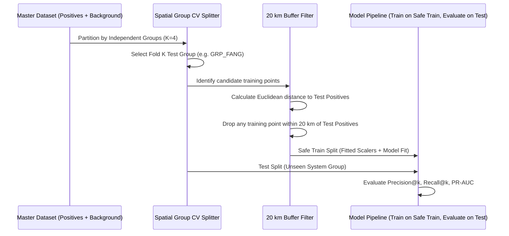

# GeoThermAI Phase 2E — Formal Spatial Validation Protocol
**Preregistered Protocol for Leak-Free, Spatially Honest Geothermal Favorability Evaluation**

**Document Version:** 1.0 (Phase 2E)  
**Date:** 2026-10-27 (Asia/Bangkok)  
**Status:** PREREGISTERED; **ENFORCED AS A MANDATORY ML GATE REQUIREMENT**

---

## 1. Protocol Objective and Scientific Rationale

In geospatial machine learning, spatial autocorrelation violates the standard assumption of Independent and Identically Distributed (I.I.D.) samples. Random cross-validation (point-wise K-Fold) produces extreme spatial leakage: training and test samples located in the same geothermal valley share identical lithology, elevation, and fault distances, creating artificially high accuracy that completely collapses when tested on new exploration targets.

This protocol pre-registers:
1. The **study area boundary** and CRS.
2. The **positive label eligibility** and withholding rules.
3. The **independent geothermal system groupings**.
4. The **Positive-Unlabeled (PU) background sampling** protocol.
5. The **spatial buffer exclusion zones** between train and test splits.
6. The **feature transformation isolation** (train-only fitting).
7. The **ranking-oriented evaluation metrics** and ablation schedules.

---

## 2. Locked Pilot Study Area Boundary

| Parameter | Specification | Scientific & Technical Justification |
|---|---|---|
| **Pilot Name** | Northern Thailand Candidate Pilot | Highest density of verified thermal springs, available DMR 1:250k geology extract, and overlapping SRTM HGT tiles. |
| **Geographic Extent (WGS84)** | Min Lon: $98.0^\circ\text{ E}$, Max Lon: $100.5^\circ\text{ E}$<br>Min Lat: $17.0^\circ\text{ N}$, Max Lat: $20.5^\circ\text{ N}$ | Fully encompasses Chiang Mai, Chiang Rai, Mae Hong Son, and Lampang geothermal fields while respecting available DMR geology and SRTM tiles. |
| **Projected Evaluation CRS** | **EPSG:32647 (WGS 84 / UTM Zone 47N)** | Metric projected coordinate reference system required for rigorous Euclidean distance and buffer calculations without spherical distortion. |
| **Target Grid Resolution** | $500\text{ m} \times 500\text{ m}$ cell size | Matches geological regional mapping scale (~1:250,000) while exceeding standard hydrothermal surface manifestation footprint (~100-300 m). |

---

## 3. Label Ingestion, Classification & Withholding Rules

### 3.1 Positive Occurrence Label Eligibility

| Category | Count in Registry | Protocol Treatment | Rationale |
|---|---|---|---|
| **Authoritative Consistent** | 14 rows | **ELIGIBLE FOR POSITIVE CLASS** | UTM coordinates match original published DMS coordinates within $< 100\text{ m}$. |
| **Provisional Southern** | 31 rows | **EXCLUDED FROM NORTHERN PILOT** | Outside Northern pilot boundary; pending UTM Zone 47N/48N resolution. |
| **Withheld Northern** | 2 rows (`CR_02`, `CM_16`) | **STRICTLY WITHHELD FROM TRAINING** | `CR_02` has unresolvable DMS-UTM mismatch; `CM_16` lacks original DMS comparator. |
| **Effective Positive Sample** | **14 sites** | Model Training & Validation Base | Effective sample size is 14, not 47. |

### 3.2 Independent Hydrothermal System Grouping
Manifestations occurring within a shared fault block, hydrothermal circulation plume, or recharge basin cannot be split across training and test folds.

```
Site Group ID | Included Record UIDs | Pilot Geographic Area
-------------+----------------------+-----------------------
GRP_FANG     | NR_01, NR_02         | Fang Basin (Chiang Mai)
GRP_SKP      | NR_03, NR_04         | San Kamphaeng (Chiang Mai)
GRP_PAI      | NR_05                | Pai Basin (Mae Hong Son)
GRP_MAE_CHAN | NR_06, NR_07         | Mae Chan Fault Zone (Chiang Rai)
GRP_WANG_NUA | NR_08, NR_09         | Wang Nua / Lampang
GRP_OTHER_N  | NR_10..NR_14         | Individual isolated springs
```
> [!IMPORTANT]
> Formal domain sign-off from a qualified structural geologist is required before these groups are finalized for production ML fitting.

---

## 4. Positive-Unlabeled (PU) Background Sampling

1. **No True Negatives:** The model assumes all unobserved cells are unlabeled background, NOT dry wells.
2. **Positive Exclusion Buffer (5,000 m):** A $5\text{ km}$ buffer is established around all 47 registry manifestation locations. No background point may be sampled within this zone to prevent sampling the active geothermal discharge apron as "background".
3. **Sampling Density:** Background points are sampled uniformly at random across the locked pilot region at a **50:1 ratio** relative to positive instances ($N_{\text{background}} \approx 700\text{ points}$).
4. **Sensitivity Testing:** Alternative sampling ratios of 10:1, 20:1, and 100:1 must be tested to evaluate rank stability.

---

## 5. Buffered Group Spatial K-Fold Cross-Validation



### 5.1 Validation Fold Isolation Rules
1. **Group Isolation:** $TrainGroups \cap TestGroups = \emptyset$. An entire geothermal system is held out together.
2. **Spatial Buffer Isolation ($20\text{ km}$):** Any sample located within $20,000\text{ m}$ of a test positive point is purged from the training set of that fold.
3. **Data Transformation Isolation:**
   - Standardizers (`TrainFoldScaler`) compute mean and variance exclusively on the safe training split.
   - Encoders (`TrainFoldOneHotEncoder`) define category matrices strictly on the safe training split.
   - Test data statistics are NEVER visible during model training.

---

## 6. Leakage Prevention Checklist

- [x] **No Target Proximity Feature:** `distance_known_manifestation_m` is strictly blacklisted in `prediction_architecture.py`.
- [x] **No Target Density Feature:** Kernel density or point density of known manifestations is forbidden.
- [x] **No Information Leakage Across Folds:** Feature normalizers fitted strictly on train indices.
- [x] **No Future Temporal Leakage:** Data acquisition dates documented; static features only.
- [x] **No Coordinate Overfitting:** Raw latitude and longitude are NOT permitted as direct model predictors.

---

## 7. Preregistered Model Evaluation Protocol

### 7.1 Competing Models (Evaluated on Identical Folds)
1. **Model A (Baseline):** Play Fairway Analysis (PFA) GIS heuristic using lithology, fault distance, and focal relief.
2. **Model B (Statistical ML):** L2-Regularized Logistic Regression under Positive-Unlabeled empirical risk.
3. **Model C (Tree ML):** Shallow Random Forest (max depth 4, 50 estimators, min samples leaf 5).

### 7.2 Performance Reporting Metrics
All results must be reported in a standard table across all 4 folds:

| Model ID | Mean PR-AUC | PR-AUC Std | Recall@Top 10% Area | Recall@Top 20% Area | Precision@k | Rank Stability |
|---|---|---|---|---|---|---|
| **Model A (PFA Baseline)** | *To be computed upon gate approval* | — | — | — | — | Baseline |
| **Model B (Reg. Logistic)** | *To be computed upon gate approval* | — | — | — | — | — |
| **Model C (Tree Ensemble)** | *To be computed upon gate approval* | — | — | — | — | — |

### 7.3 Feature Ablation Protocol
Leave-one-family-out ablation must be executed:
1. Model C without Geology family ($\Delta \text{PR-AUC}$).
2. Model C without Structural Proximity family ($\Delta \text{PR-AUC}$).
3. Model C without Terrain Relief family ($\Delta \text{PR-AUC}$).

If removing a feature family causes no degradation or improves performance, that family must be pruned to avoid overfitting.

---

## 8. External Geographic Holdout Plan

Once Northern Thailand models are validated, an external holdout test will be conducted in **Western / Southern Thailand** (e.g. Ranong / Surat Thani hydrothermal systems) after resolving coordinate and licensing clearances:
- No model parameters or hyperparameters may be re-tuned on the external holdout region.
- The external test serves as the definitive evaluation of model transferability across disparate geological domains in Thailand.
