# ข้อเสนอโครงการวิจัยฉบับปรับปรุงสมบูรณ์ — GeoThermAI (Phase 2F.2)
**เวทีการประกวด: New Gen Energy Research Showcase | หมวด: Digital Energy Transition**  
*สถานะ: ข้อเสนอโครงการฉบับปรับปรุงความพร้อมเชิงวิทยาศาสตร์และระเบียบวิธีวิจัยสากล (28 ตุลาคม 2569)*

---

## 1. ชื่อโครงการ (Project Title)

**GeoThermAI: ระบบปัญญาประดิษฐ์และสารสนเทศภูมิศาสตร์เชิงบูรณาการเพื่อคาดการณ์และจัดลำดับพื้นที่เป้าหมายการสำรวจพลังงานความร้อนใต้พิภพของประเทศไทย**  
*(GeoThermAI: An Integrated Geoscience AI and GIS Prospectivity Prediction and Exploration Decision-Support System for Thailand)*

---

## 2. ปัญหาและความสำคัญ (Problem Statement & Rationale)

พลังงานความร้อนใต้พิภพ (Geothermal Energy) เป็นพลังงานสะอาดประเภท Baseload ที่มีความมั่นคงสูง สามารถจ่ายพลังงานได้ต่อเนื่องตลอด 24 ชั่วโมง และมีอัตราการปล่อยก๊าซเรือนกระจกต่ำมาก ซึ่งเป็นปัจจัยสำคัญต่อยุทธศาสตร์การเปลี่ยนผ่านสู่พลังงานสะอาด (Energy Transition) และเป้าหมาย Net Zero ของประเทศไทย อย่างไรก็ตาม **อุปสรรคสำคัญที่สุดที่ขัดขวางการลงทุนพัฒนาพลังงานความร้อนใต้พิภพคือ "ความเสี่ยงและต้นทุนการเจาะสำรวจขั้นต้นที่สูงมาก (High Upstream Exploration Risk & Drilling Capital Expenditure)"** โดยการเจาะหลุมสำรวจทางลึกแต่ละหลุมมีค่าใช้จ่ายหลายสิบล้านบาท และมีโอกาสล้มเหลวสูงหากตำแหน่งหลุมไม่ตัดผ่านโครงข่ายรอยเลื่อนที่มีการไหลเวียนของของไหลร้อน

ในอดีต การประเมินพื้นที่ศักยภาพในประเทศไทยมักพึ่งพาการสืบค้นข้อมูลเชิงคุณภาพหรือการอาศัยเพียง "ระยะห่างจากน้ำพุร้อนผิวดิน" ซึ่งมีจุดอ่อนร้ายแรง 2 ประการ:
1. **ไม่สามารถค้นพบระบบกักเก็บใต้ผิวดินแบบปิด (Blind / Concealed Geothermal Systems):** แหล่งกักเก็บความร้อนหลายแห่งไม่มีน้ำพุร้อนผุดขึ้นมาบนผิวดินเนื่องจากถูกปิดกั้นด้วยชั้นหินปิดทับ (Caprock) หรือระดับน้ำบาดาลตื้น
2. **ปัญหา Spatial Data Leakage ในการประยุกต์ใช้ AI:** งานวิจัย AI ด้านธรณีวิทยาจำนวนมากในอดีตนำพิกัดน้ำพุร้อนผิวดินมาใช้ฝึกสอนและทดสอบโมเดลโดยตรง โดยไม่ตระหนักว่าจุดน้ำพุร้อนผิวดินหลายจุดแท้จริงเกิดจาก **"แหล่งกักเก็บเดียวกัน (Common Hydrothermal Plume)"** ทำให้โมเดลจดจำพิกัดพื้นที่ใกล้เคียงและรายงานความแม่นยำสูงเกินจริง ($>95\%$) แต่ล้มเหลวโดยสิ้นเชิงเมื่อนำไปใช้งานจริงในแอ่งสำรวจใหม่

---

## 3. ช่องว่างการวิจัยและการเปรียบเทียบกับงานวิจัยสากล (Research Gap & Benchmark)

โครงการ GeoThermAI วางตำแหน่งทางวิชาการโดยยึดหลักการ **REPLICATE → ADAPT → VALIDATE → IMPROVE** โดยอ้างอิงจากงานวิจัยมาตรฐานสากลของสำนักงานสำรวจทางธรณีวิทยาสหรัฐฯ (USGS):
> **Mordensky, S. P., Lipor, J. J., DeAngelo, J., Burns, E. R., & Lindsey, C. R. (2023).**  
> *When less is more: How increasing the complexity of machine learning strategies for geothermal energy assessments may not lead toward better estimates.*  
> *Geothermics*, 110, 102662. DOI: [10.1016/j.geothermics.2023.102662](https://doi.org/10.1016/j.geothermics.2023.102662)

### การเปรียบเทียบทางระเบียบวิธีวิจัย:

| มิติการวิจัย | แบบจำลองมาตรฐาน USGS (Mordensky et al., 2023) | การปรับใช้ใน GeoThermAI (บริบทประเทศไทย) |
|---|---|---|
| **พื้นที่ศึกษา** | ฝั่งตะวันตกของสหรัฐฯ ($725,442$ เซลล์ ขนาด $2\text{ km} \times 2\text{ km}$) | พื้นที่ศึกษาภาคเหนือ ($102,125.39\text{ km}^2$, ประมาณ $25,507$ เซลล์) |
| **ตัวแปรนำเข้าหลัก (5)**| 1. Heat Flow ($\text{mW/m}^2$) 2. Distance to Quaternary Faults ($\text{km}$) 3. Distance to Quaternary Magma ($\text{km}$) 4. Seismic Event Density ($M \ge 3$ ในรัศมี 4 กม.) 5. Maximum Horizontal Stress ($S_{Hmax}$ azimuth) | ปรับใช้ตามข้อมูลไทยที่ตรวจสอบสิทธิ์แล้ว (ดูรายละเอียดในตารางจับคู่ตัวแปร) พร้อมวิเคราะห์ความไม่แน่นอน |
| **สมมติฐานการเรียนรู้** | Positive-Unlabeled (PU) Learning ($P=278$, $U=725,164$) | Positive-Unlabeled (PU) Learning (ไม่ทึกทักว่าพื้นที่ไม่มีน้ำพุร้อนเป็นพื้นที่ไร้ศักยภาพ) |
| **การประเมินผล** | Normal-Score Transformation เปรียบเทียบอันดับความเหมาะสม | Normal-Score Transformation จัดลำดับ Relative Favorability Ranking โดยไม่กล่าวอ้างความน่าจะเป็นลวง |
| **การสกัดกั้นข้อมูลรั่วไหล** | สุ่มแบ่ง Train/Test 80/20 ในระดับภูมิภาค | **Group-Preserving Spatial Validation:** รวมน้ำพุร้อนที่อยู่ในระบบเดียวกันให้อยู่ใน Fold เดียวกัน และทดสอบ Buffer สกัดกั้น 5–30 กม. |

---

## 4. วัตถุประสงค์และสมมติฐานการวิจัย (Objectives & Hypotheses)

### วัตถุประสงค์:
1. **พัฒนาแพลตฟอร์มสารสนเทศภูมิศาสตร์เชิงบูรณาการ (Traceable Geoscience GIS Platform):** เชื่อมโยงข้อมูลหิน รอยเลื่อน แหล่งน้ำพุร้อน ความสูงภูมิประเทศ และจุดวัดความร้อน พร้อมระบบตรวจสอบความครอบคลุมเชิงเรขาคณิตจริง (Geodesic Ellipsoidal Area)
2. **สถาปนาระบบตรวจสอบความพร้อมทางวิทยาศาสตร์ (Fail-Closed Scientific ML Gate):** ปิดกั้นการทำนายเชิงตัวเลขลวงจนกว่าชุดข้อมูลและสิทธิ์ทางกฎหมายจะผ่านการรับรองจากผู้เชี่ยวชาญ 9 ข้อ
3. **พัฒนาไปป์ไลน์ Replicate วิธีวิจัย USGS ในสภาพแวดล้อมแยกอิสระ:** เพื่อเป็นฐานอ้างอิงเปรียบเทียบมาตรฐานสากลภายใต้ป้ายกำกับ `USGS_REPLICATION_ONLY`
4. **วางกรอบระเบียบวิธีวิจัย Positive-Unlabeled (PU) Learning สำหรับประเทศไทย:** คัดกรองและจัดลำดับความเหมาะสมของพื้นที่สำรวจ (Favorability Ranking) โดยไม่สร้างอคติเชิงลบต่อพื้นที่ที่ยังไม่มีการสำรวจ

### สมมติฐานการวิจัย (Research Hypotheses):
- **สมมติฐานที่ 1:** แบบจำลองเชิงสถิติที่ไม่ซับซ้อนแต่ควบคุมอคติได้ดี (เช่น Regularized Logistic Regression หรือ Tree Ensemble) จะให้ความเสถียรและความสามารถในการอธิบายโครงสร้างธรณีวิทยาได้ดีกว่าแบบจำลอง Black-Box ที่ซับซ้อนสูงภายใต้สภาวะข้อมูลที่มีความไม่สมบูรณ์
- **สมมติฐานที่ 2:** การจัดกลุ่มน้ำพุร้อนให้อยู่ในระบบเดียวกันและการกำหนด Buffer สกัดกั้นเชิงพื้นที่ (Spatial Buffer 5–30 กม.) จะป้องกันปรากฏการณ์ Spatial Overfitting และสะท้อนความสามารถในการค้นพบแหล่งความร้อนใหม่ในแอ่งสำรวจอื่นได้อย่างแท้จริง

---

## 5. แผนผังกระบวนการวิจัย (Two-Track Research Architecture)

```mermaid
flowchart TD
    subgraph TrackA["ลู่ทางที่ 1: การจำลองงานวิจัยสากล (USGS Benchmark Sandbox)"]
        A1["ข้อมูลมาตรฐาน USGS (DOI: 10.5066/P9V1Q9XM)"] --> A2["ตรวจสอบความถูกต้องและ Checksum"]
        A2 --> A3["เตรียมตารางกริด 2 กม. x 2 กม. (725,442 เซลล์)"]
        A3 --> A4["ทดสอบโมเดล LR และ XGBoost ภายใต้ PU Learning"]
        A4 --> A5["แปลงคะแนนด้วย Normal-Score Transformation N(0,1)"]
        A5 --> A6["รายงานผลการ Replicate (กำกับ: USGS_REPLICATION_ONLY)"]
    end

    subgraph TrackB["ลู่ทางที่ 2: ระบบพยากรณ์สำหรับประเทศไทย (Thailand Exploration System)"]
        B1["ข้อมูลธรณีศาสตร์ไทย (DMR, SRTM, TMD, IHFC)"] --> B2["ตรวจสอบพิกัดและความครอบคลุม Geodesic WGS84"]
        B2 --> B3["คัดกรองพิกัด 47 จุด (14 จุดสอดคล้อง, 31 จุดชั่วคราว, 2 จุดระงับ)"]
        B3 --> B4{"ระบบตรวจวัดความพร้อม Fail-Closed ML Gate (9 เงื่อนไข)"}
        B4 -- "สถานะปัจจุบัน: NO-GO" --> B5["ปิดกั้นการฝึกโมเดลและห้ามแสดง Heatmap ทำนาย"]
        B4 -- "เมื่อได้รับอนุมัติครบ" --> B6["ฝึกสอนโมเดลด้วย Group-Preserving Spatial CV"]
        B6 --> B7["จัดทำแผนที่ระดับความเหมาะสม Relative Favorability Map"]
        B7 --> B8["ระบบสนับสนุนการตัดสินใจเจาะสำรวจ (De-risking Geothermal Wells)"]
    end

    style TrackA fill:#f7fafc,stroke:#4a5568,stroke-width:2px
    style TrackB fill:#ffffff,stroke:#2b6cb0,stroke-width:2px
    style B4 fill:#fff5f5,stroke:#e53e3e,stroke-width:3px
    style B5 fill:#fed7d7,stroke:#9b2c2c,stroke-width:2px
```

---

## 6. สถานะความพร้อมของชุดข้อมูลในปัจจุบันและข้อจำกัดทางกายภาพ

จากผลการคำนวณด้วยเรขาคณิตระนาบรูปทรงรี WGS84 Geodesic ในพื้นที่ศึกษาภาคเหนือ ($102,125.39\text{ km}^2$):

1. **ระดับความสูงภูมิประเทศ (SRTM DEM):**
   - มีข้อมูลจริงในคลัง 5 ระวาง คิดเป็นพื้นที่ครอบคลุมเชิงเรขาคณิต **$51.37\%$** ($52,466.80\text{ km}^2$)
   - ขาดอีก 7 ระวาง อยู่ระหว่างขั้นตอนดาวน์โหลดจาก USGS EarthExplorer เพื่อขยายให้ครบ 100%
2. **แผนที่ธรณีวิทยา 1:250,000 กรมทรัพยากรธรณี (DMR Geology):**
   - ครอบคลุมพื้นที่เชิงเรขาคณิต **$44.73\%$** ($45,675.59\text{ km}^2$)
   - ขอบด้านตะวันตก ($98.0^\circ\text{–}98.26^\circ\text{ E}$) และขอบด้านตะวันออกเฉียงใต้ยังขาดระวางเชื่อมต่อ
3. **พื้นที่ทับซ้อนที่ใช้งานได้จริงในปัจจุบัน (Combined Usable Predictors):**
   - พื้นที่ที่ข้อมูล SRTM DEM และหิน DMR ทับซ้อนร่วมกันมีขนาด **$34,523.06\text{ km}^2$ ($33.80\%$)**
   - คิดเป็นเซลล์กริดขนาด $2\text{ km} \times 2\text{ km}$ ที่พร้อมนำไปใช้งานวิจัยทั้งสิ้น **8,630 เซลล์**
4. **แนวรอยเลื่อนมีพลัง (DMR Active Fault Zones):**
   - มีข้อมูลเส้น 630 เส้นในเครื่อง แต่ติดข้อจำกัดด้านสิทธิ์การเผยแพร่ข้อมูลอนุพันธ์ จึงถูก **ระงับการนำเข้าโมเดล (Blocked)** จนกว่าจะได้รับหนังสืออนุญาตจากกรมทรัพยากรธรณี
5. **การไหลของความร้อน (IHFC Heat Flow):**
   - มีจุดวัด 154 จุดทั่วประเทศ (63 จุดในภาคเหนือ) แต่จุดวัดเบาบางมาก **สั่งห้ามทำ Spatial Kriging Interpolation เด็ดขาด** เพื่อป้องกันการสร้างภาพลวงตาความร้อน

---

## 7. แผนการทดสอบเชิงทดลองและการตรวจสอบความถูกต้อง (Validation Plan)

เมื่อ ML Gate ผ่านการอนุมัติ โครงการจะดำเนินการทดสอบตามระเบียบวิธีที่ลงทะเบียนล่วงหน้า:
1. **การจำแนกระบบอิสระ (Hydrothermal System Clustering):** ให้นักอุทกธรณีวิทยาตรวจสอบและลงนามรับรองกลุ่มระบบน้ำพุร้อน 6–10 ระบบในภาคเหนือ
2. **การทดสอบความไวของ Buffer (5, 10, 15, 20, 30 กม.):** เปรียบเทียบค่า PR-AUC เพื่อวัดอิทธิพลของ Spatial Autocorrelation
3. **เกณฑ์การไม่รายงานผลลวง (Truthful Non-Estimability Criteria):** หากผู้เชี่ยวชาญยืนยันว่ามีระบบอิสระน้อยกว่า 5 ระบบ ระบบจะระบุสถานะเป็น `EVALUATION_NOT_ESTIMABLE` ทันทีเพื่อรักษาจรรยาบรรณวิจัย

---

## 8. ประโยชน์ที่คาดว่าจะได้รับและสมมติฐานโมเดลธุรกิจ (Benefits & Business Impact)

### ประโยชน์ต่อการเปลี่ยนผ่านพลังงาน (Energy Transition):
- **ลดความเสี่ยงการลงทุนเจาะหลุมสำรวจ (Upstream Exploration De-risking):** ช่วยให้ กฟผ., กรมพัฒนาพลังงานทดแทนฯ (พพ.) หรือผู้ลงทุนเอกชน สามารถคัดกรองพื้นที่ความเสี่ยงสูงออกไปก่อนตัดสินใจทุ่มงบประมาณเจาะสำรวจหลุมลึก (มูลค่าหลุมละ 30–50 ล้านบาท)
- **สนับสนุน Baseload Renewable Energy:** ปลดล็อกศักยภาพพลังงานความร้อนใต้พิภพในภาคเหนือเพื่อเป็นพลังงานสะอาดรองรับภาคอุตสาหกรรมและชุมชน

### สมมติฐานโมเดลธุรกิจ (Business Model Hypothesis):
- ให้บริการรายงานวิเคราะห์พื้นที่ศักยภาพ (Geothermal Prospectivity Intelligence Reports) แก่ผู้พัฒนาโครงการพลังงานสะอาด
- ให้บริการแพลตฟอร์มบูรณาการข้อมูลธรณีศาสตร์เชิงลึกสำหรับองค์กรพลังงานภาครัฐและเอกชน

---

## 9. ความเป็นไปได้และแผนงานในอนาคต (Implementation Milestones)

| ขั้นตอน (Milestone) | ระยะเวลา | กิจกรรมหลัก | ผลผลิตที่ตรวจสอบได้ |
|---|---|---|---|
| **Phase 2F.2 (ปัจจุบัน)** | ตุลาคม 2569 | ตรวจสอบพิกัด Geodesic, แยกไปป์ไลน์ USGS Replicate, สถาปนา Fail-Closed ML Gate | รายงานผลการวิจัยและโค้ดระบบที่ผ่านการทดสอบ 100% |
| **Phase 3.1** | ไตรมาส 1/2570 | ยื่นหนังสือขออนุญาต DMR, ดาวน์โหลด SRTM 7 ระวางที่ขาด, เชิญผู้เชี่ยวชาญตรวจทานพิกัด | ได้รับหนังสืออนุญาต DMR และมีข้อมูลความสูงครบ 100% |
| **Phase 3.2** | ไตรมาส 2/2570 | ปลดล็อก ML Gate, ฝึกสอนโมเดล PU Learning บนพื้นที่ภาคเหนือ, วิเคราะห์ Buffer Sensitivity | แผนที่ Relative Favorability Map ฉบับแรกของภาคเหนือ |
| **Phase 4** | ไตรมาส 3/2570 | ทดสอบโมเดลกับพื้นที่ควบคุมอิสระทางภูมิศาสตร์ (External Geographic Holdout ภาคตะวันตก) | รายงานความถูกต้องเชิงพื้นที่ฉบับสมบูรณ์เพื่อการลงทุนจริง |
