# Independent Research Pipelines — Phase 2F.2
**GeoThermAI Two-Track Architecture & Decoupling Governance**  
*Date: 28 October 2026 | Project: GeoThermAI (CoreX) | Lead AI Research & Engineering Team*

---

## 1. Architectural Strategy: Two Decoupled Research Tracks

To ensure absolute scientific reproducibility while maintaining strict adherence to Thai legal and data readiness gates, GeoThermAI establishes **Two Independent Pipelines**:

```mermaid
flowchart TD
    subgraph TrackA["PIPELINE A: USGS Original Research Replication (Benchmark Sandbox)"]
        A1["USGS Original Data\n(ScienceBase DOI: 10.5066/P9V1Q9XM)"] --> A2["Source Verification & Checksums\n(SHA-256 Catalog Audit)"]
        A2 --> A3["Spatial & Data Preprocessing\n(2 km x 2 km Equal-Area Grid, N=725,442)"]
        A3 --> A4["Feature Engineering (5 Canonical Features)\n(Heat Flow, Fault Dist, Magma Dist, Seismic Density, SHmax)"]
        A4 --> A5["Positive-Unlabeled Dataset Construction\n(P=278 known positives, U=725,164 background)"]
        A5 --> A6["Model Training & Cross-Validation\n(Standardized Logistic Regression & XGBoost)"]
        A6 --> A7["Model Evaluation & Ranking Metrics\n(PR-AUC, ROC-AUC, Brier, Recall @ Top 10% Area)"]
        A7 --> A8["Comparative Favorability Maps\n(Normal-Score Transformation N(0,1))"]
        A8 --> A9["Replication Audit Report\n(Tagged: USGS_REPLICATION_ONLY)"]
    end

    subgraph TrackB["PIPELINE B: Thailand GeoThermAI Prediction (Gated Exploration Track)"]
        B1["Thai Geoscience Data\n(DMR Geology, Faults, SRTM DEM, IHFC Heat Flow)"] --> B2["Data Quality, CRS & Provenance\n(WGS84 Ellipsoidal Geodesic Calculator)"]
        B2 --> B3["Geospatial Harmonization & Masking\n(Combined Usable Predictors: 33.80% Coverage)"]
        B3 --> B4["Feature Engineering & Unit Adaptation\n(PHASE2F2_THAILAND_FEATURE_MAPPING.csv)"]
        B4 --> B5["Independent Ground Truth Review\n(47 Manifestation Points -> 6-10 Hydrothermal Systems)"]
        B5 --> B6{"Fail-Closed Scientific ML Gate\n(9 Review Requirements / Status: NO-GO)"}
        B6 -- "BLOCKED (Current State)" --> B6_Block["Runtime Enforcement:\nPredictive Model Fitting DISABLED\nSpatial Interpolation DISABLED\nProspectivity Heatmap DISABLED"]
        B6 -- "UNLOCKED (When 9/9 Approved)" --> B7["Spatial Group Cross-Validation\n(Buffer Sensitivity 5-30 km, Block Holdouts)"]
        B7 --> B8["Thailand Favorability Mapping\n(Relative Prospectivity Ranking)"]
        B8 --> B9["Explainable Decision Support\n(De-risking Geothermal Exploratory Wells)"]
    end

    style TrackA fill:#f4f6f9,stroke:#4a5568,stroke-width:2px
    style TrackB fill:#fefefe,stroke:#2b6cb0,stroke-width:2px
    style B6 fill:#fff5f5,stroke:#e53e3e,stroke-width:3px
    style B6_Block fill:#fed7d7,stroke:#9b2c2c,stroke-width:2px
    style A9 fill:#ebf8ff,stroke:#3182ce,stroke-width:2px
```

---

## 2. Track Governance & Cross-Track Leakage Prevention

| Governance Parameter | Pipeline A (USGS Research Replication) | Pipeline B (Thailand Prediction System) |
|---|---|---|
| **Primary Scientific Reference** | Mordensky et al. (2023), *Geothermics* 110:102662 | Geothermal Play Fairway Analysis (PFA) & Adapted PU Learning |
| **Geographic Scope** | Western United States (13 Western States) | Northern Thailand Pilot ($98.0^\circ\text{--}100.5^\circ\text{ E}, 17.0^\circ\text{--}20.5^\circ\text{ N}$) |
| **Dataset Provenance** | USGS Curated Release (DOI: [10.5066/P9V1Q9XM](https://doi.org/10.5066/P9V1Q9XM)) | DMR Thailand, Royal Thai Survey Dept, TMD, IHFC |
| **Runtime Execution Status** | **ACTIVE (Sandbox Execution Enabled)** | **DISABLED (Fail-Closed Gate: `NO_GO_FOR_PREDICTIVE_ML`)** |
| **Mandatory Tagging** | `USGS_REPLICATION_ONLY` | `THAILAND_GEOTHERMAL_RESEARCH` |
| **Output Guardrail** | Programmatic assertion `assert_usgs_sandbox_isolation()` raises error if output claims Thai prospectivity | Model interface raises `MLGateBlockedError` if training or prediction is attempted while gate is blocked |
| **Intended Utility** | Methodological verification, algorithm benchmarking, baseline sanity checking | Exploration decision support, well de-risking, national renewable energy planning |

---

## 3. Strict Decoupling Rules

1. **No Metric Contamination:**
   USGS benchmark accuracy or PR-AUC metrics must **NEVER** be cited, displayed, or implied as the accuracy of GeoThermAI in Thailand.
2. **No Model Transfer Without Calibration:**
   Models fitted on Basin and Range extensional faults and young North American volcanics cannot be deployed directly onto Thailand's strike-slip granitic batholith terrain without complete local retraining and independent validation.
3. **No Target Leakage:**
   Thai manifestation locations are strictly protected; proximity to known positive manifestations is prohibited from being used as a predictive feature in model training.
4. **Independent Versioning:**
   Replication artifacts are maintained under `tasks/phase_2f2_replication_verification/` and `src/geothermai/usgs_replication.py`, distinct from the Thai operational GIS engine in `src/geothermai/prediction_architecture.py`.
