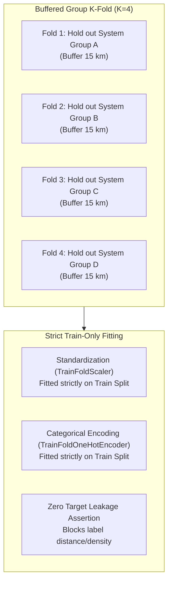

# GeoThermAI Phase 2F — Scientific Validation Preregistration
**Preregistered Spatial Holdout, Buffer Sensitivity, Positive-Unlabeled Learning, and Non-Estimability Criteria**

**Document Version:** 1.0 (Phase 2F)  
**Date:** 2026-10-27 (Asia/Bangkok)  
**Status:** PREREGISTERED SCIENTIFIC SPECIFICATION — **NO MODEL TRAINING AUTHORIZED**

---

## 1. Scientific Target Definition and Claim Boundaries

### 1.1 Target Concept
$$\text{Relative Geothermal Exploration Favorability} \in [0, 1]$$
An uncalibrated, ordinal ranking quantifying the relative confluence of geological, structural, and topographic indicators associated with hydrothermal activity.

### 1.2 Boundary of Inferences (Strict Non-Claims)
- **Not Occurrence Probability:** Favorability scores cannot be mathematically equated to $P(\text{geothermal reservoir present} = 1)$.
- **Not Drilling Success Rate:** No inference regarding commercial well productivity, flow rate (kg/s), or enthalpy (kJ/kg) is supported.
- **Not Power Capacity:** No megawatt (MW) or levelized cost of energy (LCOE) figures are computed.
- **No Unlabeled-as-Negative Claim:** Unsurveyed cells are modeled strictly as unlabeled background, never as confirmed absence.

---

## 2. Spatial Autocorrelation & Buffer Sensitivity Protocol

### 2.1 The Buffer Distance Hypothesis
Phase 2E proposed a 20 km spatial buffer as an initial working heuristic. In Phase 2F, this parameter is formally classified as a **research hypothesis to be empirically evaluated**, NOT a universal constant.

In Northern Thailand's complex strike-slip terrain:
- Individual hydrothermal systems (e.g. Kok River vs Mae Chan) are separated by approximately $25\text{–}30\text{ km}$.
- San Kamphaeng and Doi Saket are separated by approximately $25\text{ km}$.
- Setting a buffer too large ($> 30\text{ km}$) purges virtually all viable training background points in the intermontane valleys.
- Setting a buffer too small ($< 5\text{ km}$) allows deep meteoric recharge circulation and structural fracture branches to leak between training and validation splits.

### 2.2 Buffer Sensitivity Grid Schedule
When the ML Gate opens, the evaluation pipeline will execute an automated buffer sensitivity grid:

| Buffer Distance | Physical Geological Rationale | Expected Effect on Training Samples | Overfitting / Leakage Risk |
|:---:|---|---|---|
| **$5\text{ km}$** | Excludes immediate thermal spring discharge apron and shallow run-off | Maximizes available training samples; retains local valley background | High risk of fracture-network autocorrelation leakage |
| **$10\text{ km}$** | Excludes immediate local fault segment and hydrothermal alteration zone | Moderate training sample retention | Moderate risk in tightly clustered fault corridors |
| **$15\text{ km}$** | Approximates regional hydrothermal circulation convective radius | Balanced sample retention across intermontane basins | Recommended default candidate for Northern strike-slip systems |
| **$20\text{ km}$** | Phase 2E baseline candidate; spans entire local graben sub-basin | Significant reduction in training background points | Low leakage risk; possible sample sparsity in small pilots |
| **$30\text{ km}$** | Conservative regional tectonic isolation | Severe purging of training points in adjacent valleys | Extreme risk of sample starvation; likely triggers non-estimability |

---

## 3. Positive-Unlabeled (PU) and Background Sampling Protocol

Because Thailand possesses zero documented negative dry exploratory drillholes, standard supervised binary classification is mathematically invalid.

1. **Label Assumption (Selected At Random - SAR):**  
   We assume known hot springs are an incomplete sample of positive geothermal manifestations:
   $$P(s=1 \mid x, y=1) = c, \quad P(s=1 \mid x, y=0) = 0$$
   Where $s \in \{0, 1\}$ is the observed registry status, and $y \in \{0, 1\}$ is latent hydrothermal presence.
2. **Positive Exclusion Buffer ($5\text{ km}$):**  
   Background points are sampled exclusively outside a $5\text{ km}$ exclusion radius around all 47 manifestation coordinates to ensure no active manifestation apron is labeled as background.
3. **Sampling Ratio Sensitivity:**  
   Background-to-positive sampling ratios of **10:1, 20:1, 50:1, and 100:1** will be evaluated to verify that favorability rankings remain invariant to background sample density.
4. **Evaluation Metric Formulation:**  
   Models will be evaluated using Area Under the Precision-Recall Curve (PR-AUC / Average Precision) and the Positive-Unlabeled empirical risk estimator (Elkan & Noto, 2008; du Plessis et al., 2014), NOT naive classification accuracy or binary F1.

---

## 4. Group-Preserving Spatial Cross-Validation

### 4.1 Group Isolation Invariants
- Manifestations belonging to the same `system_group_id` must never be divided across training and test splits.
- All points within the chosen buffer distance of any test positive are purged from the training split of that fold.
- `TrainFoldScaler` and `TrainFoldOneHotEncoder` calculate parameters strictly from the training split; unseen categories in test splits map to an explicit `UNKNOWN` column.

---

## 5. Formal Non-Estimability Criteria (`EVALUATION_NOT_ESTIMABLE`)

A primary flaw in contemporary literature (Aliyu et al., 2026) is the insistence on publishing headline performance metrics even when the effective independent sample size is too small to yield statistically meaningful results.

GeoThermAI establishes a formal **Non-Estimability Policy**:

> [!IMPORTANT]
> **Criteria for Declaring `EVALUATION_NOT_ESTIMABLE`:**
> If any of the following conditions occur during experiment execution:
> 1. **Insufficient Independent Groups:** The expert-adjudicated independent system count in the pilot area is $< 5$ systems.
> 2. **Sample Starvation:** The spatial buffer exclusion purges $> 85\%$ of candidate training points in any fold.
> 3. **Degenerate Folds:** Any validation fold contains zero positive test instances after group isolation.
> 4. **Spatial Over-fitting:** Spearman rank correlation of predictions across resampled folds is $< 0.30$.
>
> The pipeline **MUST STOP**, log decision state **`EVALUATION_NOT_ESTIMABLE`**, and report the exact data deficiency. The system is strictly forbidden from publishing unvalidated, high-variance accuracy scores.

---

## 6. Pre-Registered Model Comparison & Ablation Schedule

When the ML Gate is formally approved, the pipeline will evaluate three models on identical spatial splits:

1. **Model A (Baseline):** Play Fairway Analysis (PFA) GIS heuristic combining lithology, fault distance, and focal relief.
2. **Model B (Statistical ML):** L2-Regularized Logistic Regression under Positive-Unlabeled empirical risk.
3. **Model C (Tree Ensemble):** Shallow Random Forest (max depth 3–4, 50 estimators, min samples per leaf 5).

### Leave-One-Family-Out Ablation Schedule:
- Baseline Model C (All permitted features: Geology, Terrain, Structures)
- Ablation 1: Model C without Geology family ($\Delta \text{PR-AUC}$)
- Ablation 2: Model C without Structural Proximity family ($\Delta \text{PR-AUC}$)
- Ablation 3: Model C without Terrain Relief family ($\Delta \text{PR-AUC}$)

Any feature family that fails to demonstrate a statistically meaningful improvement ($\Delta \text{PR-AUC} > 0.02$) under spatial holdout will be pruned from the final model to prevent dimensionality inflation.
